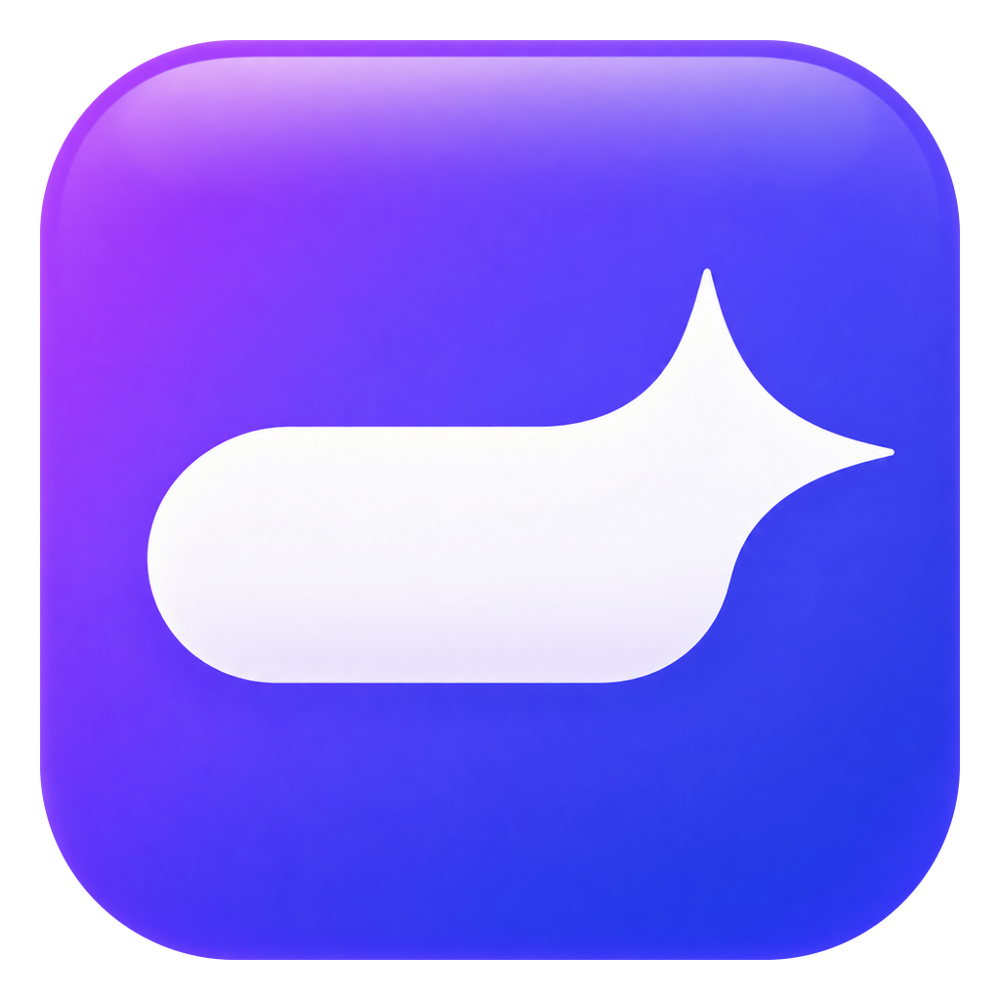
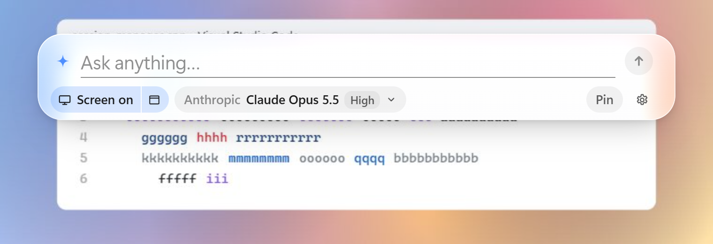
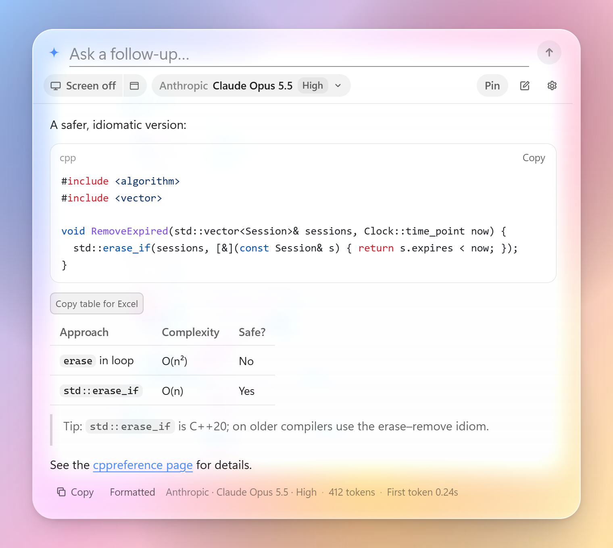
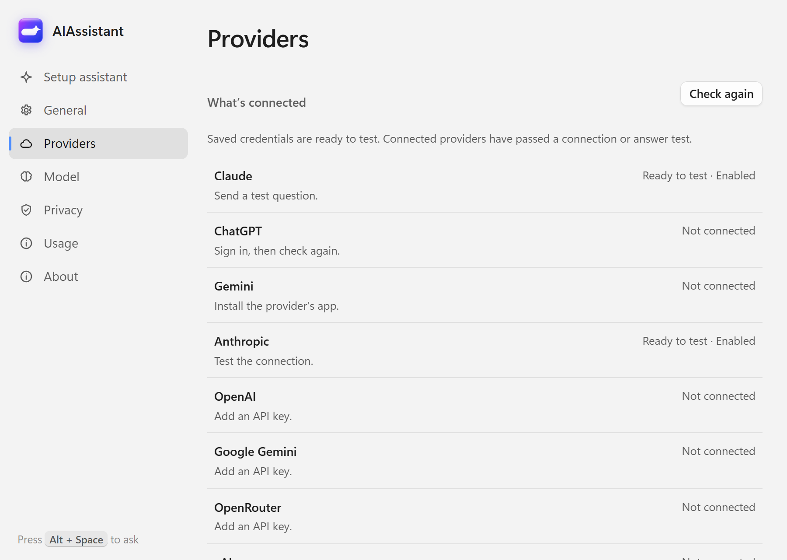

<div align="center">



# AIAssistant

**A quick, private AI assistant for Windows.**<br>
Press <kbd>Alt</kbd>+<kbd>Space</kbd> anywhere and a glass message bar drops in. Ask with your screen as context, or just ask.

[](https://github.com/GitLeon123/aiassistant/releases/latest)
[](https://github.com/GitLeon123/aiassistant/releases)


[**Download for Windows**](https://github.com/GitLeon123/aiassistant/releases/latest) · [Features](#features) · [Providers](#providers) · [Privacy](#privacy) · [Building](#building)

<br>

<picture>
  <source media="(prefers-color-scheme: dark)" srcset="docs/images/bar-dark-empty.png">
  
</picture>

</div>

## Features

- 🖼️ **See exactly what you share.** The Screen chip opens a preview of the exact image attached to your next question, with its monitor, size, provider, model and **Local/Cloud** destination. Remove it with one click. Sensitive-window blocking is on by default.
- 🔑 **Use the subscriptions you already pay for.** Claude (via Claude Code), ChatGPT (via the Codex CLI) and Google (via the Gemini CLI). AIAssistant runs the official CLI you're signed in to, with tools disabled, in an empty temporary folder. It never sees your subscription credentials.
- 🔌 **Or bring an API key, or run models locally.** Supports nine API providers, any OpenAI-compatible endpoint, Ollama and LM Studio. Keys are stored in Windows Credential Manager.
- ⚡ **Switch on the fly.** Change model and reasoning level from the bar (<kbd>Ctrl</kbd>+<kbd>M</kbd>). Follow-up questions continue the conversation.
- 📋 **Answers you can reuse.** Markdown, code highlighting and LaTeX all render locally. Copy as Markdown, as formatted text for Word/Outlook, or as a table for Excel.
- ✨ **Liquid-glass look.** Spring animations that follow your Windows light/dark setting and accent colour, and respect "Animation effects" being off.
- ♿ **Accessible.** Optional solid surfaces, 100–200% text size, Windows Contrast themes, full keyboard support and screen-reader announcements.
- 🛡️ **Usage safeguards.** An optional daily allowance guard for API spending.

<div align="center">
<picture>
  <source media="(prefers-color-scheme: dark)" srcset="docs/images/bar-dark-answer.png">
  
</picture>
</div>

## Install

1. Download **`AIAssistant-<version>-Setup.exe`** from the [latest release](https://github.com/GitLeon123/aiassistant/releases/latest).
2. Run it. You don't need a terminal or admin rights. The installer adds Microsoft WebView2 if it's missing (that step needs internet).
3. The **Setup assistant** opens. It finds your existing CLI sign-ins and local Ollama/LM Studio servers, suggests a provider, can send a text-only test question, and helps you pick a shortcut.

Starting with Windows is optional, and you can uninstall from **Settings → Apps → Installed apps**.

> [!NOTE]
> Builds are currently **unsigned**, so SmartScreen may warn on first run. Choose **More info → Run anyway**. To verify the download, compare its SHA-256 with the `.sha256` file attached to the release.

## Using it

| Keys | In the bar |
|---|---|
| <kbd>Alt</kbd>+<kbd>Space</kbd> | Open / close (change in Settings → General) |
| <kbd>Enter</kbd> / <kbd>Shift</kbd>+<kbd>Enter</kbd> | Send / new line |
| <kbd>Esc</kbd> | Close the model picker, stop a running answer, or close the bar |
| <kbd>Ctrl</kbd>+<kbd>S</kbd> | Toggle screen context |
| <kbd>Ctrl</kbd>+<kbd>M</kbd> | Choose model and reasoning (<kbd>Alt</kbd>+<kbd>←</kbd>/<kbd>→</kbd> changes the level) |
| <kbd>Ctrl</kbd>+<kbd>N</kbd> | New chat |
| <kbd>Ctrl</kbd>+<kbd>Shift</kbd>+<kbd>C</kbd> | Copy the last answer |
| <kbd>Ctrl</kbd>+<kbd>,</kbd> | Settings |

- **Alt+Space conflicts:** Windows also uses it for the system menu, and launcher apps often claim it. <kbd>Ctrl</kbd>+<kbd>Alt</kbd>+<kbd>Space</kbd> is a good alternative.
- **Conversations** reset after 10 idle minutes (configurable in Settings → Privacy).
- **Pin** keeps the bar open when another app gets focus. The shortcut, the Close button and <kbd>Esc</kbd> still close it.
- **System prompt:** the built-in prompt asks the model to state uncertainty, avoid invented menu or payment details, and treat screenshot content as untrusted. A custom system prompt replaces it.

## Providers

<picture>
  <source media="(prefers-color-scheme: dark)" srcset="docs/images/settings-dark-providers.png">
  
</picture>

**Subscriptions** (via the official CLI)
- Claude: Claude Code
- ChatGPT: Codex CLI
- Google: Gemini CLI

**API keys**
- Anthropic, OpenAI, Google Gemini
- OpenRouter, xAI, Groq, Mistral, DeepSeek
- Any OpenAI-compatible endpoint

**Local**
- Ollama
- LM Studio

**Settings → Providers** shows what's connected and the next step for each provider.

<br clear="right">

### Connecting a subscription

1. Install the CLI and sign in:
   - **Claude:** `npm i -g @anthropic-ai/claude-code`, then `claude` and `/login`
   - **ChatGPT:** `npm i -g @openai/codex`, then `codex login`
   - **Gemini:** `npm i -g @google/gemini-cli`, then `gemini`
2. Open **Settings → Providers**, press **Check again** if needed, and switch the provider on.

Use a recent Codex CLI (tested with 0.161.0). Codex runs with `--ignore-user-config` and `--ignore-rules`, with coding plugins, MCP servers, hooks, shell tools and web search disabled. It keeps its own sign-in credentials and uses AIAssistant's system prompt and the reasoning level you selected.

API keys are stored in Windows Credential Manager (`AIAssistant/<provider>`). They are never written to disk and never sent to the UI.

## Privacy

AIAssistant is designed to keep your data local, but it is honest about its limits.

- **What's captured:** the bar takes a frozen screenshot when it opens, even when Screen is off, because it's also used for the glass backdrop. If the active window is blocked, both the context capture and the backdrop refresh are skipped.
- **Blocking:** the default block list covers common password managers and remote desktop clients, plus recognizable banking and private-browser window titles. Title matching is incomplete, so check the preview when other sensitive windows are visible on the same monitor.
- **Storage:** captures and API conversation history stay in memory. Earlier screenshots remain in the API conversation until you start a New chat; switching providers from the model picker also starts a new chat. Codex and Gemini receive a temporary image file that is deleted after the run, although an interrupted process can leave one behind.
- **Limits:** CLIs and providers may retain their own data. Windows capture exclusion is best-effort and not a security guarantee. Network behaviour has not been audited in every mode, so we make no "no telemetry" claim. See the [privacy verification record](docs/privacy-verification.md).

<details>
<summary><b>Usage allowance guard details</b></summary>

CLI quota is shown as unknown unless the CLI reports a supported warning. The optional daily API allowance guard in **Settings → Usage** reserves a user-chosen amount per request. It does **not** measure or cap provider billing; use your provider's billing controls for real spending limits.

Retries and setup test questions count toward it. Reservations are kept for stopped or failed calls, and the guard resets at local midnight. Local loopback Ollama/LM Studio and subscription CLIs are exempt; remote local-provider endpoints count. Reservations are stored in `%LOCALAPPDATA%\AIAssistant\usage-budget.json`, which holds only the date and total. See [Phase 3/4 verification](docs/phase34-verification.md).

</details>

### Command line

```
AIAssistant.exe               start (opens Setup assistant until setup is complete)
AIAssistant.exe --toggle      open/close the bar, e.g. from another launcher
AIAssistant.exe --settings    open Settings
AIAssistant.exe --background  start quietly in the tray (used by "Start with Windows")
```

A second launch hands off to the running instance.

### Files

| What | Where |
|---|---|
| Settings (no secrets) | `%APPDATA%\AIAssistant\settings.json` |
| Log (no message contents, no keys) | `%LOCALAPPDATA%\AIAssistant\aiassistant.log` |
| WebView2 profile | `%LOCALAPPDATA%\AIAssistant\WebView2` |

## Building

**Requirements:** Windows 10 1903+ or Windows 11, Visual Studio 2026 with the C++ workload and Windows SDK 10.0.22621+, CMake 3.25+, Node.js 20+, and the WebView2 Runtime (preinstalled on Windows 11).

```powershell
cmake --preset msvc-x64
cmake --build --preset msvc-x64-release
ctest --preset msvc-x64-release
.\build\msvc-x64\Release\AIAssistant.exe
```

The native build runs `npm install && npm run build` in `ui/` and copies the result next to the exe. Pass `-DAIASSISTANT_BUILD_UI=OFF` to skip that step, for example when you're only working on C++. CMake fetches the dependencies (WebView2 SDK, nlohmann/json, doctest).

**Installer:** install [Inno Setup 6.3+](https://jrsoftware.org/isdl.php), then run `cmake --build --preset msvc-x64-release --target aiassistant_installer`. The setup executable and its SHA-256 file are written to `build/msvc-x64/installer/`. See [setup verification](docs/setup-verification.md).

**Icon:** `assets/logo.png` is the master artwork. `scripts/make-icon.ps1` regenerates `resources/app.ico` from it.

### Working on the UI

The UI is Svelte 5 + TypeScript in `ui/`. In a browser it runs against a mock host, with fake providers, fake streaming, and a fake desktop behind the glass:

```powershell
cd ui
npm install
npm run dev          # http://localhost:5747/bar.html and /settings.html
npm run check        # svelte-check + TypeScript
npm run test         # destination and math-token regression tests (Node.js 22.6+)
npm run test:browser # privacy, setup and Phase 3/4 workflows; needs dev server and Edge
npm run test:phase34 # Phase 3/4 workflows, clipboard fixtures and accessibility checks
```

To hot-reload the real app against the dev server:

```powershell
$env:AIASSISTANT_DEV_URL = "http://localhost:5747"
.\build\msvc-x64\Release\AIAssistant.exe
```

<details>
<summary><b>Mock URL parameters</b></summary>

- **Bar:** `?theme=light|dark`, `?accent=%23ff6a00`, `?reduced` (reduced motion), `?hidden` (start closed; Alt+Space or a click opens it).
- **Capture:** `?blocked=password|banking|private|remote` shows the capture block notice; `?preview-error` shows a failed preview.
- **Routing:** `?provider=ollama&endpoint=http://localhost:11434/v1` exercises local routing (try a remote endpoint to check the Cloud label). Asking a question that contains "error" shows the error state.
- **Settings:** `?first-run` opens setup, `&no-node&no-providers` shows missing dependencies, `&setup-error` fails the test, `&slow-test` lets you try stopping, `&hotkey-conflict` starts with an unavailable shortcut.
- **Accessibility/answers:** `?solid&text-scale=200`, `&pinned`, `&math&fast`, `&budget=0.25`, `&limit-warning`.

Browser tests use only synthetic prompts, providers and clipboard data, so they consume no subscription or API usage.

</details>

<details>
<summary><b>Live subscription smoke tests</b></summary>

These are separate from the unit tests. They use only **GPT-6 Luna** and **Haiku**, with synthetic prompts and images, and report time to first text and to completion. They check system instructions, follow-up history, image input and cancellation. **They consume usage from the signed-in subscriptions.**

```powershell
cmake --preset msvc-x64 -DAIASSISTANT_BUILD_LIVE_TESTS=ON
cmake --build --preset msvc-x64-release --target aiassistant_live_tests
.\build\msvc-x64\Release\aiassistant_live_tests.exe
# Optional: test only codex-cli or claude-cli by passing that provider ID.
```

</details>

<details>
<summary><b>Developer switches</b></summary>

Set these environment variables to `1`:

- `AIASSISTANT_DEVTOOLS`: enables WebView2 DevTools.
- `AIASSISTANT_ALLOW_CAPTURE`: doesn't exclude the bar from screen capture, so you can screenshot it. This also stops the live glass refresh, which would otherwise capture the bar itself.

</details>

### Project layout

```
src/app         App: message loop, bar/settings lifecycle, UI protocol
src/platform    hotkey, tray, theme, autostart, screen capture, Credential Manager
src/ui          WebView2 host and windows (transparent overlay, Mica settings)
src/providers   Anthropic, OpenAI Responses, OpenAI-compatible, Gemini, CLI bridges
src/net         WinHTTP streaming + SSE parser
src/core        settings, paths, hotkey parsing, logging
ui/src/bar      the bar: glass panel, streaming markdown, model picker
ui/src/settings the settings window
tests/          doctest unit tests (SSE, hotkeys, request builders, CLI event parsing)
```

---

<div align="center">
<sub>Created in <a href="https://t3.codes">T3 Code</a>.</sub>
</div>
